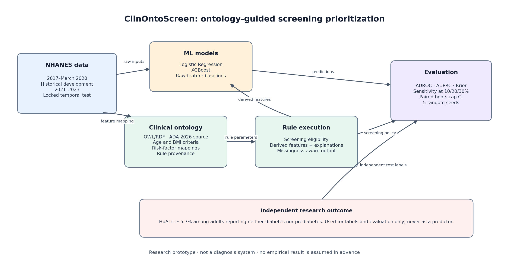
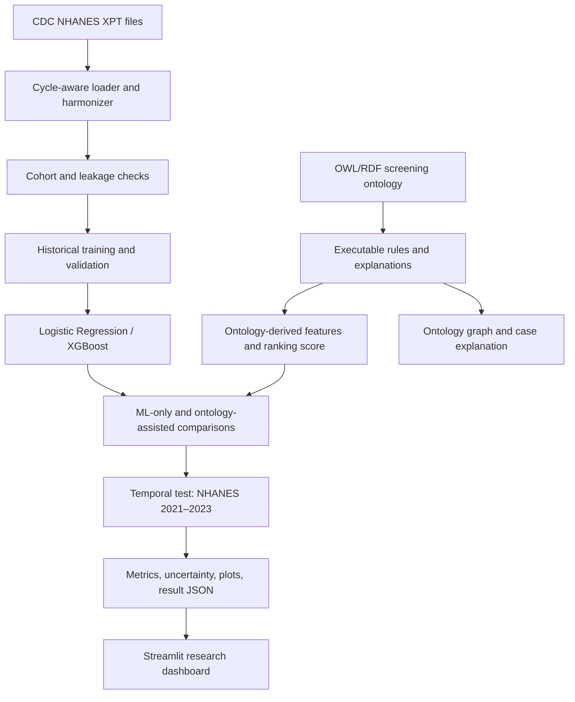

# ClinOntoScreen

**Ontology-guided screening prioritization for HbA1c-defined dysglycemia using NHANES.**

ClinOntoScreen is a research prototype that compares conventional tabular ML with an explicit clinical knowledge layer. It uses public NHANES data, a versioned RDF/OWL screening ontology, Logistic Regression and XGBoost, a reproducible Kaggle/Colab notebook, and a Streamlit dashboard.

> **Research-only notice:** This project is not a medical device, is not clinically validated, and must not be used to diagnose or treat a person. A single NHANES HbA1c measurement is a research label, not a confirmed diagnosis.

## Research question

At a fixed screening capacity, does an ontology-assisted ML policy identify more participants with HbA1c-defined screen-positive dysglycemia than an ML-only policy on a later NHANES cycle?

The project also assesses whether ontology-derived features affect AUROC, AUPRC and calibration, whether a rule-based review signal adds value beyond model confidence, and how policies behave at fixed screening capacity (10/20/30%) against the prevalence ceiling `min(1, capacity/prevalence)`.

## Results (canonical run, 2026-10-30)

Protocol frozen at git tag `protocol-v1` before any 2021–2023 outcome was read; full provenance and
number-by-number log in [`docs/DECISIONS.md`](docs/DECISIONS.md) and
`artifacts/research_results.json → protocol`.

| Finding | Value |
|---|---|
| Cohorts | Historical 2017–Mar 2020: n = 6,103 (28.9% positive); temporal test 2021–2023: n = 4,260 (23.1% positive) |
| **Primary (confirmatory): hybrid − ML-only sensitivity @20%** | **−0.0031, 95% CI [−0.0100, +0.0079]** — null, inside the pre-registered MDE (0.0143) |
| Best capacity policy | Logistic + ontology features: sensitivity 0.423 @20% (0.488 of the 0.867 ceiling), PPV 0.488, lift 2.12 |
| Trained models vs published CDC/ADA risk test | AUPRC 0.460–0.463 vs 0.380; sensitivity@20% 0.407–0.423 vs 0.372 |
| Knowledge-layer direction by family (exploratory) | Logistic +0.0092 sens [−0.0038, +0.0185]; XGBoost −0.0031 [−0.0181, +0.0114] — both below MDE |
| Missing-input stress (E2, exploratory) | Hybrid keeps the top AUPRC at every masking rate; logistic + ontology degrades least at 30% masking |
| Disagreement review (H3, exploratory) | Precision 0.360 vs size-matched confidence review 0.400 — not enriched |

Full manuscript draft with all tables: [`paper/CLINONTOSCREEN_PAPER.md`](paper/CLINONTOSCREEN_PAPER.md).
The pre-addendum Colab run is preserved unmodified in `artifacts_colab_2026-10-29/` (see its README).

## Architecture






## Data and outcome

- Historical development: NHANES 2017–March 2020 pre-pandemic public release.
- Locked temporal test: NHANES August 2021–August 2023.
- Cohort: adults aged 18+ who report neither prior diabetes nor prior prediabetes and have a valid HbA1c result.
- Primary research outcome: `LBXGH >= 5.7%`, called **HbA1c-defined screen-positive dysglycemia**. It is not a confirmed clinical diagnosis.
- `LBXGH`, diabetes questionnaire fields, glucose/glycemic labs, and treatment variables must not be model predictors.

The CDC indicates that the 2021–2023 cycle uses an updated sample design and modified questionnaires/examination procedures. This is a later-cycle generalization study, not proof that a particular event caused distribution shift. Read the cycle-specific analytic guidance before making population-level claims.

### Official source links

- [NHANES 2021–2023 files and documentation](https://wwwn.cdc.gov/nchs/nhanes/continuousnhanes/default.aspx?Cycle=2021-2023)
- [NHANES 2017–March 2020 pre-pandemic files and documentation](https://wwwn.cdc.gov/nchs/nhanes/continuousnhanes/default.aspx?Cycle=2017-2020)
- [2021–2023 demographics codebook](https://wwwn.cdc.gov/Nchs/Data/Nhanes/Public/2021/DataFiles/DEMO_L.htm)
- [2021–2023 diabetes questionnaire codebook](https://wwwn.cdc.gov/Nchs/Data/Nhanes/Public/2021/DataFiles/DIQ_L.htm)
- [2021–2023 HbA1c codebook](https://wwwn.cdc.gov/Nchs/Data/Nhanes/Public/2021/DataFiles/GHB_L.htm)
- [ADA Standards of Care 2026: diagnosis and classification](https://diabetesjournals.org/care/article/49/Supplement_1/S27/163926/2-Diagnosis-and-Classification-of-Diabetes)

## Repository map

```text
plan.md                         Full research and engineering plan
plan_addendum.md                Amendment: capacity endpoints, E1–E3, published baseline, MDE
METHODOLOGY.md                  Outcome, model, ontology and evaluation definitions
DATA_DICTIONARY.md              Canonical feature and NHANES-source mapping
paper/CLINONTOSCREEN_PAPER.md   Manuscript draft (all numbers from run artifacts)
ontology/diabetes_screening.ttl Versioned RDF/OWL knowledge model
notebooks/01_nhanes_ontology_ml.ipynb
                                Kaggle/Colab download, train, evaluate and export workflow
tools/nb_cells/ + build_notebook.py
                                Plain-Python cell sources the notebook is generated from
src/clinontoscreen/             Reusable data, ontology, modeling and reporting code
app.py                          Streamlit results dashboard and interactive case explorer
docs/                           Paper, experiment, figure and decision logs (incl. post-run log)
tests/                           Leakage, ontology and data contract tests
artifacts/                       Canonical run outputs (ignored by Git)
artifacts_colab_2026-10-29/     Superseded pre-addendum Colab run, preserved with README
```

## Run in Kaggle or Google Colab

1. Upload/open `notebooks/01_nhanes_ontology_ml.ipynb` in Kaggle or Colab.
2. Enable internet access for the runtime. The notebook downloads the public XPT files directly from CDC; no API key is required.
3. Run every cell from top to bottom. Do not skip cohort/label validation cells.
4. Training evaluates Logistic Regression and XGBoost on raw and ontology-derived features, tunes only on historical data, then evaluates the locked 2021–2023 cycle.
5. Download the generated `artifacts/` outputs. Keep participant-level predictions private unless you have reviewed whether and how they should be shared.

CPU is sufficient. XGBoost does not require a GPU for these tabular data.

## Run the dashboard locally

```bash
python -m venv .venv
# Windows PowerShell:
.venv\Scripts\Activate.ps1
# macOS/Linux:
# source .venv/bin/activate
python -m pip install -r requirements.txt
streamlit run app.py
```

The ontology graph and rule explanation view can run before model training. After the notebook finishes, copy the generated `artifacts/` files (or extract `clinontoscreen_artifacts.zip`) into this repository’s `artifacts/` directory. Result charts and ML-based example scores become available only when `artifacts/model_bundle.joblib` and `artifacts/research_results.json` are present. The app shows an explicit setup message rather than inventing placeholder metrics.

## Run tests

```bash
python -m pytest -q
```

The test suite checks the data/leakage contract, ontology rules and graph, artifact serialization, and notebook/ontology consistency. The notebook is intentionally committed without execution outputs so no one mistakes placeholder values for results.

## Research integrity

- The final temporal test data are never used for model selection, rule-weight tuning or threshold selection; the protocol is frozen at git tag `protocol-v1` before test outcomes are read, and the run records its commit/tag relation.
- One confirmatory hypothesis (H2) only; everything else is labelled exploratory, with a smallest detectable difference computed on historical validation before test access.
- Preprocessing is fitted on historical training data only.
- All comparisons use the same eligible temporal test cohort, and every capacity row reports prevalence, the capacity ceiling, PPV and lift — not sensitivity alone.
- Results include class prevalence, confidence intervals and five training seeds.
- A generic feature-engineering control is included; the ontology is not credited with a metric gain that can be explained by equivalent features alone.
- Rule disagreement is not described as proof of uncertainty.
- Race/ethnicity-sensitive rules receive a documented ablation and fairness discussion.
- Every paper table/figure is generated from saved result artifacts.

Read [plan.md](plan.md) before implementing changes. The detailed study protocol is in [METHODOLOGY.md](METHODOLOGY.md), and the data contract is in [DATA_DICTIONARY.md](DATA_DICTIONARY.md).
